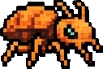

# 🛡️ HELLDIVERS 2: DEFENDERS OF DEMOCRACY (DESKTOP NATIVE)

Juego 2D de acción y supervivencia militar táctica inspirado en **Helldivers 2**, desarrollado en **C# (.NET 10)** con el motor gráfico nativo **Raylib-cs**.



## 🎮 Características Principales

- **Diseños Auténticos de Enemigos (Pixel Art):** 28 sprites extraídos y remasterizados directamente con animaciones de paso, destellos de impacto, sombras y comportamiento táctico.
- **2 Facciones Icónicas:**
  - **Termínidos:** Carroñeros, Saltadores, Guerreros, Cazadores, Acechadores, Guardias de Colmena, Comandantes de Prole, Vomitadores de Bilis y Titanes Colosales.
  - **Autómatas:** Soldados esqueléticos, Asaltantes, Comisarios con sable térmico, Berserkers con sierras mecánicas giratorias, Devastadores pesados/coheteros, Zancudos exploradores, Hulks acorazados y Caminantes de Fábrica.
- **Terminal de Bestiario Táctico (24 Especies y Modelos):**
  - Cuadrícula táctica 4x3 para cada facción.
  - Escáner holográfico con radar giratorio y retícula sobre puntos débiles.
  - Informes balísticos desclasificados de Super Tierra y manuales de supervivencia y armamento recomendado.
- **Arsenal y Estratagemas:**
  - Armas primarias balísticas y de energía con selector de cadencia y retroceso.
  - Zambullida táctica evasiva (`Espacio`) para esquivar cargas de Chargers y proyectiles.
  - Estratagemas de apoyo orbital (Ataques aéreos Eagle 500kg, Láseres orbitales, Torretas defensivas).
  - Zona de extracción perimetral con aterrizaje del transbordador Pelican-1.
- **Audio y Efectos Visuales:** Sistema de sonido procedural y sintético de alta fidelidad, partículas de sangre/chispas y números de daño crítico.

## 🕹️ Controles

| Tecla / Control | Acción |
| :--- | :--- |
| **W, A, S, D** | Movimiento del Helldiver |
| **Mouse (Apuntar)** | Dirección de la mira y del fusil |
| **Clic Izquierdo** | Disparar arma primaria |
| **Clic Derecho** | Granada táctica de fragmentación |
| **Espacio** | **Zambullida Táctica** (evasión de embestidas) |
| **R** | Recargar cargador |
| **1, 2, 3, 4** | Activar Estratagema en slot correspondiente |
| **Tab / M** | Abrir Minimapa / Radar táctico |
| **Escape (ESC)** | Pausa / Volver al Puente de Mando |

## 🚀 Requisitos y Ejecución

### Requisitos:
- **.NET 10.0 SDK** (o posterior) en Windows x64.

### Para ejecutar:
```powershell
dotnet run -c Release
```
O ejecutando directamente el binario generado:
```powershell
.\bin\Release\net10.0\HelldiversDesktop.exe
```
